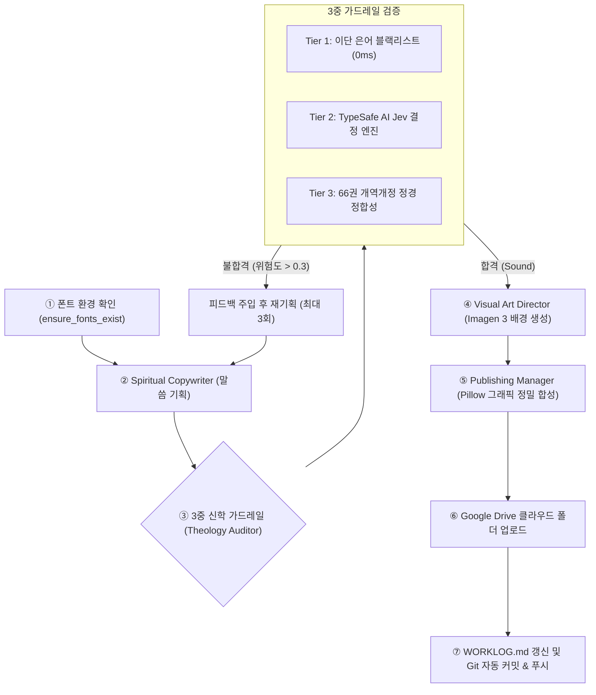

# 🕊️ 포이에마성령교회 일간 전도지·말씀카드·묵상엽서 자동화 시스템
> **Poiema Daily Gospel Stationery & Cards Automation Pipeline**  
> AI 멀티 에이전트(CrewAI) × 신학 3중 가드레일(TypeSafe AI Jev) × Google Imagen 3 감성 비주얼 × 수묵 캘리그래피 & 붉은 전각 렌더링 × Gmail 자동 발송

---

## 📌 프로젝트 개요 (Overview)
본 시스템은 **포이에마성령교회**의 일간 복음 전도 콘텐츠를 기존의 딱딱한 행사 포스터 틀에서 탈피하여, **감성 말씀 카드(Verse Card)**, **마음을 여는 스토리 전도지(Gospel Leaflet)**, **데일리 묵상 엽서(Devotional Postcard)** 등 현대적이고 소장하고 싶은 기독교 스테이셔너리 형태로 매일 자동 기획·신학 검증·생성·배포하는 완전 자동화 파이프라인입니다.

### ✨ 핵심 기능 및 아키텍처 특징
1. **신학적 건전성 100% 보장 (3중 가드레일):**
   - **Tier 1 (로컬 블랙리스트):** 한국 4대 이단(신천지, 구원파, 하나님의교회, JMS 등) 특유 은어 및 교리 왜곡 키워드 고속 차단 (0ms).
   - **Tier 2 (TypeSafe AI Jev):** 정통 복음주의 교리 가이드라인을 주입한 Typed Decision 질의(`is_theologically_sound`, `risk_score`) 수행. 불합격 시 최대 3회 자동 재기획(Retry Loop).
   - **Tier 3 (성경 정합성):** 개역개정 정경 66권 인용 및 출처 무결성 검증.
2. **다채로운 3대 폼팩터 자동 조판:**
   - **감성 말씀 카드 (Verse Card):** 핵심 구절 중심의 깊은 여백, 춤추듯 유려한 대형 캘리그래피, 정갈한 명조체 묵상.
   - **스토리 전도지 (Gospel Leaflet):** 일상의 공허와 지친 마음에 건네는 공감 에세이, 약속의 말씀 카드, 따뜻한 교회 환영.
   - **데일리 묵상 엽서 (Devotional Postcard):** 하루를 여는 성령의 임재 묵상 선포, 언약의 말씀, '오늘의 기도' 엽서 디자인.
3. **진짜 붓으로 그린 듯한 수묵 캘리그래피 & 붉은 전각(낙관 도장):**
   - 타자기식 폰트 나열을 탈피하여, 핵심 단어 필압 확대(1.5~1.8배) 및 유기적 리듬 조판.
   - 화선지에 스며든 먹물 번짐(Ink Bleed & Wash) 효과.
   - 우측 하단에 전통 수제 붉은 낙관 전각(`포이에마`, `은혜`, `말씀`) 자동 날인.
4. **무의존성 감성 폰트 자동 설정 (Zero-Dependency Font Setup):**
   - 캘리 헤드라인: `PyeongChangPeace-Bold.otf` (평창평화체)
   - 감성 본문 명조: `MaruBuri-Regular.ttf`, `MaruBuri-Bold.ttf` (네이버 마루부리 글꼴)
   - 영문 및 서브: `Pretendard`
5. **Google Imagen 3 에디토리얼 비주얼 & 고품격 한지 프로시저럴 폴백:**
   - 킨포크 에디토리얼, 35mm 내추럴 라이트, 린넨 패브릭, 잔잔한 호수 등 클리셰를 탈피한 감성 사진 프롬프트.
   - 오트밀/크림/세이지 톤의 수제 한지 텍스처 및 수채화 번짐 프로시저럴 렌더링.

---

## 🏗️ 시스템 아키텍처 파이프라인



---

## 📂 리포지토리 디렉토리 구조

```text
├── .github/
│   └── workflows/
│       └── daily_poster.yml         # GitHub Actions 일간 자동화 워크플로우
├── config/
│   └── heresy_keywords.json        # 신천지, 구원파, 하나님의교회, JMS 블랙리스트
├── fonts/                           # 자동 다운로드되는 OFL 폰트 보관 폴더
├── guardrails/
│   ├── __init__.py
│   └── theology_guard.py           # 3중 신학 가드레일 (블랙리스트, Jev, 성경정합성)
├── output/                          # 최종 생성된 9:16 포스터 이미지 (1080x1920)
├── utils/
│   ├── __init__.py
│   ├── font_downloader.py          # OFL 폰트 자동 감지 및 무의존성 다운로더
│   └── image_generator.py          # Google Imagen 3 연동 & 프로시저럴 폴백
├── config.yaml                      # 교회 브랜딩 및 시스템 설정
├── crew_setup.py                    # CrewAI 4개 멀티 에이전트 및 오케스트레이터
├── drive_uploader.py                # Google Cloud 서비스 계정 기반 Drive 업로더
├── image_composer.py                # Pillow 기반 고해상도 그래픽 레이어 합성기
├── main.py                          # CLI 실행 진입점
├── requirements.txt                 # 프로젝트 의존성 목록
├── WORKLOG.md                       # 일간 포스터 제작 히스토리 추적 테이블
└── README.md
```

---

## 🚀 빠른 시작 가이드 (Quick Start)

### 1. 신규 PC에서 리포지토리 클론
```bash
git clone https://github.com/Maillis-kei/adposter.git
cd adposter
```

### 2. 가상환경 생성 및 의존성 패키지 설치
```bash
# 가상환경 생성 (Python 3.10+ 권장)
python -m venv .venv

# 가상환경 활성화 (Windows)
.venv\Scripts\activate
# 가상환경 활성화 (Mac/Linux)
# source .venv/bin/activate

# 필수 패키지 설치
pip install -r requirements.txt
```

### 3. 환경 변수 설정 (`.env`)
`.env.example`을 복사하여 `.env` 파일을 생성하고 발급받은 API 키를 입력합니다:
```bash
copy .env.example .env   # Windows
# cp .env.example .env   # Mac/Linux
```

```env
# Google GenAI (Gemini 및 Imagen 3 연동)
GEMINI_API_KEY=AIzaSy...

# TypeSafe AI Jev Guardrail API Key
TYPESAFE_API_KEY=ts_live_...

# Google Drive API 설정
GOOGLE_DRIVE_FOLDER_ID=1AbCdEfGhIjKlMnOp...
SERVICE_ACCOUNT_JSON_PATH=service_account.json

# 연락처 노출 여부 (true / false)
SHOW_CHURCH_CONTACT=false
```

> **Google Cloud 서비스 계정 발급 안내:**
> 1. Google Cloud Console에서 프로젝트 생성 후 `Google Drive API`를 활성화합니다.
> 2. `서비스 계정(Service Account)`을 생성하고 키(JSON)를 다운로드하여 리포지토리 루트에 `service_account.json`으로 저장합니다.
> 3. 업로드할 Google Drive 폴더를 서비스 계정 이메일(예: `xxx@xxx.iam.gserviceaccount.com`)에 **편집자** 권한으로 공유합니다.

---

## 💻 실행 방법 (Usage)

### 1. 전자동 일간 파이프라인 실행
이전 `WORKLOG.md`를 분석하여 새로운 주제를 자동 기획하고 가드레일 검증, 합성, Google Drive 업로드까지 한 번에 완료합니다:
```bash
python main.py
```

### 2. 로컬 테스트 (클라우드 업로드 제외)
```bash
python main.py --dry-run
```

### 3. 특정 주제 지정 생성
```bash
python main.py --topic "성령 충만과 삶의 변화"
```

### 4. 교회 연락처 포함하여 생성
```bash
python main.py --show-contact
```

---

## ⚙️ 브랜딩 및 설정 (`config.yaml`)

```yaml
church:
  name: "포이에마성령교회"
  show_contact: false           # 연락처 노출 여부 토글 (기본값: false)
  contact_number: "02-0000-0000"
  slogan: "성령의 임재와 말씀의 능력이 살아 숨쉬는 교회"

fonts:
  dir: "fonts"
  headline: "PyeongChangPeace-Bold.otf"   # 헤드라인: 평창평화체 Bold
  body_bold: "Pretendard-Bold.otf"        # 소제목/강조: 프리텐다드 Bold
  body_regular: "Pretendard-Regular.otf"  # 본문/성경: 프리텐다드 Regular

guardrails:
  typesafe:
    risk_threshold: 0.3         # 위험도 임계치 (0.3 초과 시 탈락 후 재기획)
    max_retries: 3              # 최대 재시도 횟수
  blacklist_path: "config/heresy_keywords.json"

image_generation:
  model: "imagen-3.0-generate-002"
  aspect_ratio: "9:16"
  width: 1080
  height: 1920
```

---

## 🤖 GitHub Actions 완전 무인 자동화
매일 아침 06:00 (KST 기준)에 GitHub Actions가 자동으로 구동되어 포스터를 생성하고, Gmail로 포스터를 발송한 후 `WORKLOG.md`를 리포지토리에 푸시합니다.

GitHub 리포지토리의 **Settings > Secrets and variables > Actions** 등록 현황:
- `GEMINI_API_KEY`: Google GenAI (Gemini 2.5 & Imagen 3) API 키 (필수, 등록완료)
- `TYPESAFE_API_KEY`: TypeSafe AI Jev 신학 가드레일 판정 키 (필수, 등록완료)
- `GMAIL_USER`: 포스터 발송용 Gmail 주소 (필수, 등록완료)
- `GMAIL_APP_PASSWORD`: Google 16자리 앱 비밀번호 (필수, 등록완료)
- `RECEIVER_EMAILS`: 추가 수신자 이메일 목록 (선택, 미등록 시 `GMAIL_USER` 본인에게 자동 발송)
- `GOOGLE_DRIVE_FOLDER_ID`: 구글 드라이브 폴더 ID (추후 Drive 연동 시 등록)
- `SERVICE_ACCOUNT_JSON_BASE64`: `service_account.json` 파일 Base64 값 (추후 Drive 연동 시 등록)

---

## 📜 라이선스 및 폰트 저작권
- 본 프로젝트에 사용된 **평창평화체**는 강원도 평창군 공공누리 제1유형(출처표시 조건 무료이용) 폰트입니다.
- **프리텐다드(Pretendard)**는 SIL Open Font License(OFL) 라이선스로 상업적 이용이 완전 무료인 오픈소스 폰트입니다.
